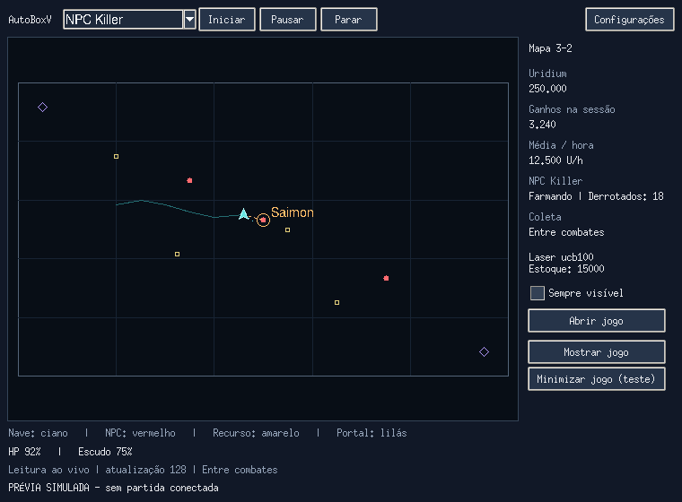

# AutoBoxV

AUTOBOXV — BETA 0.14.0

INICIAR E ATUALIZAR
Abra o navegador pelo bot e faça login com sua conta. Aguarde os dados no Painel.
Use Verificar atualizações deste bot para atualizar. Configurações e perfil do navegador são preservados.
Instalação por código: Python 3.11+ e INSTALAR_E_ABRIR.bat.
Versão executável: extraia o pacote inteiro e abra AutoBox.exe.

CONTROLES INDEPENDENTES
Coleta: F8 inicia/retoma, F9 pausa, F10 para.
Kill NPC: use Iniciar, Pausar e Parar na área NPC Killer ou na aba Kill NPC.
Pausar NPC preserva o contador; Parar encerra a sessão. Aguarde Encerrando terminar.
Parar tudo interrompe os modos. Coleta e combate não executam simultaneamente.
Um trajeto já aceito pelo jogo pode terminar após uma parada.

PAINEL
Uridium e créditos são saldos reais. XP, honra, nível e chaves verdes ficam nos indicadores menores.
Última hora soma recompensas recebidas nos últimos 60 minutos cronológicos.
Média por hora considera recompensas e tempo ativo de coleta/NPC, após 30 segundos ativos.
Compras não são descontadas do rendimento. Pausas não contam no tempo ativo.
HP e escudo são independentes; dados ausentes ficam indisponíveis.
O histórico recente é limitado. Os dados de sessão não persistem após fechar o programa.

COLETA E MAPAS
Escolhe a box mais próxima e mantém ID/revisão até terminar.
Caixas verdes são opcionais e usam chaves existentes, sem comprar chaves.
Coleta e NPC têm mapas de destino independentes. Campo vazio mantém o mapa atual.
A nave usa rotas e portais normais do cliente, sem CPU paga nem portal de galáxia.
Sem alvos, aguarda. Acompanhe a primeira viagem no jogo.
Reconexão e renascimento opcionais da coleta preservam limites de mortes e gasto.
Login continua manual. Navegador fechado pelo usuário não é reaberto automaticamente.

KILL NPC
Marque os tipos permitidos, laser, míssil e limite de vida antes de iniciar.
O farm escolhe o NPC permitido mais próximo e mantém o alvo durante a luta.
A derrota exige evidência de dano/remoção e recompensa. Dados perdidos ou ausência de progresso interrompem.
Mísseis none desativam o disparo pelo bot. O jogo controla alcance e recarga.
Reposição de munição é opcional: configure estoque mínimo, quantidade e reservas.
Compras exigem confirmação de preço, moeda e saldo.
Vida baixa aciona recuperação quando habilitada; o reparador exige equipamento e fim do ataque.
No início, vida abaixo de 80% provoca tentativa de recuperação até 90%.
Circular e levar NPC ao portal continuam opcionais. Portal não garante imunidade.

PERSEGUIÇÃO PARA FINALIZAÇÃO
Desativada por padrão. Ative na aba Kill NPC para testar acompanhado.
Uma única caixa ativa a perseguição de perto para NPCs em fuga com até 20% de HP.
Usa distância de 150 unidades, independentemente da distância normal de combate.
Limites internos de segurança: 3000 unidades e 60 segundos; não exigem configuração.
Acompanha o mesmo NPC ferido em fuga com correções suaves, sem trocar alvo.
Mantém proteções de vida, morte, mapa, alvo perdido, falta de progresso e risco no trajeto.
O modo de luta no portal tem prioridade sobre esta perseguição.
Alcance real, latência e comportamento em batalha ainda precisam de validação no jogo.

GALAXY GATE E SKYLAB
Galaxy Gate gira lotes selecionados de 100/50/10/5/1, com limite por execução.
Consumo de Uridium é opcional e respeita a reserva configurada; aguarda confirmação de cada lote.
Pause coleta/combate. Abra o painel no jogo e confirme o aviso inicial se solicitado.
Não entra nem combate nos portais.
Skylab: abra o painel Skylab no jogo, configure a reserva mínima de créditos e clique Iniciar melhorias no bot.
Melhora um módulo por vez até 20 (transporte: 1), respeitando recursos e pré-requisitos.
Aguarda cada construção terminar; não acelera com Uridium nem compra robôs ou minérios.
Não altera o estado ligado/desligado dos módulos. Se a produção estiver parada, corrija no jogo.
Parar Skylab impede novas construções; não cancela as já aceitas pelo jogo.
Pode acompanhar coleta/NPC, mas não roda junto com giros do Galaxy Gate.
Dados perdidos, morte, troca de conta ou construção sem confirmação interrompem o Skylab.
O painel deve permanecer aberto no jogo e o bot em execução; não retoma sozinho ao reabrir.
CAMUFLAGEM NA COLETA
Marque Manter nave camuflada na aba Coleta antes de iniciar. Vem desmarcada.
Usa cargas da CPU equipada na configuração ativa, sem comprar nem equipar outra.
Espera o fim dos tiros, salto e recarga; confirma camuflagem antes de repetir.
Sem CPU/cargas, avisa e continua a coleta sem camuflagem.
Sem confirmação em 20 segundos, interrompe a coleta para evitar repetir cargas.
F9/F10 também interrompem a camuflagem; não funciona no NPC Killer.
Alterações na caixa valem no próximo início. Ainda requer validação real no jogo.

DIAGNÓSTICOS
Navegador, diagnósticos e leitura técnica ficam em Avançado.
Não compartilhe seu perfil, cookies ou credenciais.
A versão de usuário não contém fontes Python soltos, mas isso não impede engenharia reversa.
A automação não tem garantia contra banimento.

VALIDAÇÃO DA 0.14.0
164 testes Python/Tkinter, ponte de navegação simulada e empacotamento/autoteste Windows.
Painel conferido com dados simulados. Perseguição não foi testada em batalha real nesta entrega.

## Cockpit compacto (em desenvolvimento na PR #2)

AutoBoxV passa a abrir em uma janela compacta com minimapa baseado em dados,
informações da nave e controles de farm. **Configurações** abre a interface completa;
**Modo compacto** no painel retorna à janela pequena. A visualização é independente
da janela do jogo e não transmite vídeo. Leitura indisponível limpa o minimapa.

Em **Kill NPC**, a tabela de perfis permite definir prioridade, laser, distância e
órbita por tipo. Um número menor tem maior prioridade. NPCs sem perfil usam as
opções gerais. Salve o perfil e reinicie o farm para aplicar.

No cockpit, **Matar + coletar** alterna lutas e pequenas sessões de coleta de caixas.
Combate e coleta não executam movimentos em paralelo. Minérios ainda dependem da
integração real. O modo de coleta entre lutas respeita a vida mínima do combate.

**Minimizar jogo (teste)** controla a janela dedicada; **Mostrar jogo** a restaura.
O funcionamento minimizado ainda exige teste real no Opera GX/Windows e na VPS.
Esta PR não publica atualização e a versão estável permanece 0.14.0.

Pendências e critérios de validação: [DEVELOPMENT_VALIDATION.md](DEVELOPMENT_VALIDATION.md).

O painel Kill NPC também mostra desempenho por tipo na sessão (derrotados, média
por ciclo, último ciclo e laser). Alvos sem progresso podem ser adiados após parada
confirmada, com limite de recuperações. O modo combinado preserva a confirmação da
camuflagem entre intervalos e aguarda seu resultado antes de atacar.
